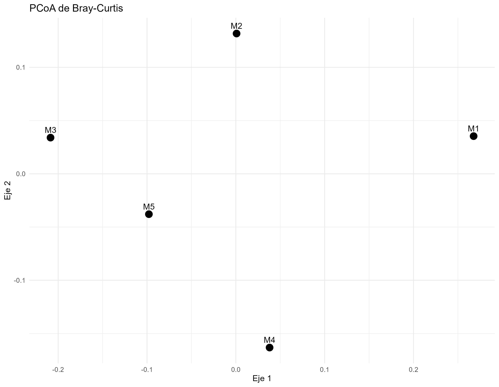

# Análisis de amplicones bacterianos 16S V4 con R y QIIME 2

**Diana Ashlyn Castillo Abad — proyecto de aprendizaje, noviembre de 2026.**

Práctica realizada durante el curso «Análisis bioinformático de metagenómica bacteriana 16S», Flyteek, impartido por Alex Andrés Jarrín Jurado. Este repositorio documenta la ejecución y adaptación del flujo docente a Ubuntu mediante WSL en Windows. No presenta un estudio experimental propio ni atribuye a la estudiante la creación de DADA2 o QIIME 2.

## Objetivo y alcance

Procesar cinco pares FASTQ de las muestras didácticas M1–M5: control de calidad, inferencia de ASVs, taxonomía, filogenia y diversidad. La procedencia biológica original y la licencia de redistribución del conjunto no están documentadas en estos archivos; no se lo identifica como muestreo propio ni se publican los FASTQ o los materiales completos del curso.

## Flujo ejecutado

FASTQ → manifiesto → importación → calidad → DADA2 → tabla y secuencias de ASVs → clasificación SILVA → barras taxonómicas → MAFFT/FastTree → rarefacción → diversidad alfa y beta → PCoA.

Parámetros DADA2: truncamiento forward/reverse 240/160; trim-left 0/0; maxEE 2/2; cuatro hilos. Clasificador recibido: `SILVA_144_SSURef_NR99_uniform_classifier_V4-515f-806r.qza`. Rarefacción exploratoria de 100 a 3700 lecturas, 20 profundidades y 10 iteraciones. Core metrics con 3000 lecturas por muestra.

## Resultados documentados

- Cinco muestras, **158 ASVs y 37 713 lecturas finales**.
- Lecturas finales M1–M5: 5015, 16822, 5482, 3715 y 6679.
- Retención global: aproximadamente 84,40 %.
- Riqueza en la tabla completa: 101, 135, 69, 87 y 91 ASVs.
- Los conteos finales coinciden con la ejecución previa de DADA2 en R. Esto no prueba identidad de todos los objetos o métodos.
- Bray–Curtis tras rarefacción: menor distancia M3–M5 (~0,277), mayor M1–M3 (~0,483).

`resultados/seguimiento_lecturas.csv` transcribe los conteos verificados en las capturas de la ejecución; no es una exportación automática del artefacto. Las exportaciones realizadas desde R se encuentran en `resultados/R/`: seguimiento de lecturas, diversidad alfa, riqueza, taxonomía, cuatro matrices de distancia, cinco figuras PNG, un árbol PDF y las versiones de R. Los artefactos QIIME 2 no están incluidos.

## Reproducción

1. Crear o activar el entorno QIIME 2 2026.10. El YAML registra el entorno Linux utilizado; no garantiza instalación idéntica en otros sistemas.
2. Obtener por una vía autorizada los pares originales comprimidos, con nombres `M1_L001_R1_001.fastq.gz` hasta `M5_L001_R2_001.fastq.gz` y el clasificador indicado.
3. Crear un directorio de ejecución vacío. Desde él ejecutar el script con las variables RAW_DIR y CLASSIFIER apuntando a rutas absolutas. El script conserva los datos de entrada.

```bash
conda activate rachis-qiime2-2026.10
RAW_DIR=/ruta/a/fastq CLASSIFIER=/ruta/al/clasificador.qza bash /ruta/al/repositorio/scripts/qiime2_v4.sh
```

El script organiza comandos observados en el historial. Se comprobó su sintaxis con `bash -n`; **esta versión reorganizada no se ejecutó de extremo a extremo**. La rarefacción aleatoria puede producir cifras diferentes al repetirla. Consultar las versiones en `reproducibilidad/`.

## Interpretación y límites

ASV no equivale necesariamente a especie; lecturas no equivalen a células ni demuestran viabilidad, actividad o función. No se documentan grupos experimentales reales ni se presentan pruebas de tratamiento. La taxonomía de esta ejecución usa SILVA 144 y no es directamente intercambiable con SILVA 138.2 utilizada en R. El árbol de QIIME 2 se construyó con MAFFT/FastTree y difiere del flujo filogenético de R.

## Estado y próximos pasos

Práctica V4 ejecutada. Exportaciones de R incorporadas. Pendiente técnico: verificar los scripts reorganizados en una ejecución limpia. Las condiciones de reutilización del material docente no están documentadas. El ejercicio independiente V3–V4 no forma parte de estos resultados. Scripts de R integrados en cinco etapas (01–05). Los bloques de árbol y UniFrac se reconstruyeron a partir de las instrucciones y salidas de la sesión. El modelo de R utilizó una categoría de tasas (sin gamma); no se calculó bootstrap.

## Reconocimientos y referencias

- Curso Flyteek y guía docente `QIIME2_16S_V4_pipeline.pdf`.
- QIIME 2: https://qiime2.org/
- DADA2: https://benjjneb.github.io/dada2/
- SILVA: https://www.arb-silva.de/

No se asigna una licencia de redistribución a material de terceros cuyo permiso no esté documentado.

## Ruta en R

Configurar `RAW_DIR` (FASTQ sin comprimir), `SILVA_TRAIN` y `SILVA_SPECIES` mediante `Sys.setenv()` y ejecutar 01, 02 y 03 en orden en una misma sesión. El bloque 04 reconstruye el árbol GTR con una categoría de tasas y calcula UniFrac; puede tardar. El bloque 05 exporta objetos ya calculados sin repetir ese procesamiento. Las etiquetas ASV abreviadas del árbol son identificadores de presentación, no nombres de especies.

Se ajustaron los patrones FASTQ para excluir las copias `.gz`, se retiró el bloque que usaba `ps` antes de construirlo y se separó la filogenia del pipeline inicial. No se incluyen grupos Control/Tratado no confirmados como diseño experimental. Estas adaptaciones requieren validación en una ejecución limpia; la evidencia disponible corresponde a los resultados observados durante la práctica guiada.

## Figuras exportadas en R




Otras figuras: [géneros](resultados/R/g_generos.png), [taxones principales](resultados/R/g_top10.png), [mapa de calor](resultados/R/g_heatmap.png) y [árbol de 20 ASVs](resultados/R/arbol_20_ASVs.pdf).

La diversidad alfa exportada en R usa la tabla completa y Shannon con logaritmo natural. QIIME 2 utiliza aquí una tabla rarefactada a 3000 lecturas y Shannon en base 2; los valores no deben compararse directamente. El árbol en R utiliza GTR, una categoría de tasas, sin gamma ni bootstrap, y enraizamiento por punto medio.
