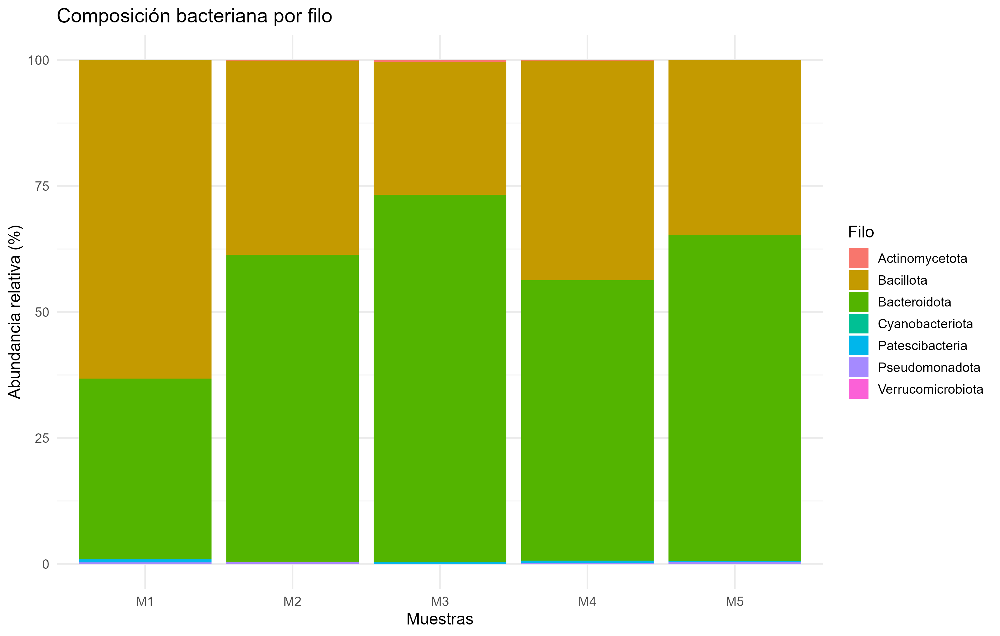

# Análisis de amplicones del gen 16S rRNA: región V4

**Diana Ashlyn Castillo Abad**  
Práctica de bioinformática · Noviembre de 2026

## Descripción

Este repositorio reúne los procedimientos y resultados del análisis de cinco muestras del curso «Análisis bioinformático de metagenómica bacteriana 16S», impartido por Alex Andrés Jarrín Jurado en Flyteek. El procesamiento se realizó con DADA2 en R y QIIME 2. Se documentan el filtrado de lecturas, la inferencia de variantes de secuencia de amplicón (ASVs), la asignación taxonómica, la reconstrucción filogenética y el cálculo de diversidad.

Los datos corresponden a las muestras M1–M5 proporcionadas para la práctica. La información disponible no permite establecer su procedencia biológica ni definir grupos de comparación. El análisis se presenta como un ejercicio de formación.

## Objetivo

Obtener una tabla de ASVs a partir de lecturas pareadas de la región V4 del gen 16S rRNA y describir la composición taxonómica y la diversidad de las cinco muestras.

## Procedimiento

### Procesamiento de secuencias

En ambas rutas se utilizó DADA2 para filtrar las lecturas, estimar los errores, inferir ASVs, unir los pares y eliminar quimeras. Las secuencias forward y reverse se truncaron a 240 y 160 bases, respectivamente, con un máximo de dos errores esperados por lectura. En QIIME 2 se estableció `trim-left` en 0 para ambas direcciones y se utilizaron cuatro hilos.

La ruta de QIIME 2 incluyó la preparación del manifiesto, la importación de archivos FASTQ comprimidos y la inspección de la calidad. En R se emplearon los archivos sin comprimir. Los patrones de búsqueda del script de R excluyen las copias `.gz` para evitar la selección de duplicados.

### Asignación taxonómica

En R se utilizó SILVA 138.2. En QIIME 2 se aplicó el clasificador `SILVA_144_SSURef_NR99_uniform_classifier_V4-515f-806r.qza`. Los resultados de cada ruta se conservan por separado debido a las diferencias entre las versiones de referencia y los procedimientos de clasificación.

### Filogenia y diversidad

En QIIME 2, las secuencias se alinearon con MAFFT y el árbol se obtuvo con FastTree. Las curvas de rarefacción se calcularon entre 100 y 3700 lecturas, con 20 profundidades y 10 iteraciones. El análisis de diversidad mediante `core-metrics-phylogenetic` se realizó a 3000 lecturas por muestra.

En R, la reconstrucción filogenética incluyó alineamiento, un árbol inicial de unión de vecinos y optimización con el modelo GTR. Se utilizó una categoría de tasas, sin distribución gamma, y enraizamiento por punto medio. No se calculó soporte mediante bootstrap. El árbol se incorporó al objeto de phyloseq para obtener las distancias UniFrac ponderada y no ponderada.

También se calcularon las distancias Bray–Curtis y Jaccard. La ordenación se representó mediante análisis de coordenadas principales (PCoA).

## Resultados

El procesamiento produjo **158 ASVs y 37 713 lecturas después de eliminar quimeras**, con una retención global del 84,40 %.

| Muestra | Lecturas de entrada | Lecturas finales | ASVs observadas en la tabla completa |
| --- | ---: | ---: | ---: |
| M1 | 5869 | 5015 | 101 |
| M2 | 19 620 | 16 822 | 135 |
| M3 | 6758 | 5482 | 69 |
| M4 | 4448 | 3715 | 87 |
| M5 | 7989 | 6679 | 91 |

Los conteos finales de DADA2 coincidieron entre R y QIIME 2. Esta coincidencia se refiere al número de lecturas y ASVs; no establece que todos los objetos, asignaciones taxonómicas o cálculos posteriores sean idénticos.

En QIIME 2, después de rarefactar a 3000 lecturas, la distancia Bray–Curtis fue menor entre M3 y M5 (0,277) y mayor entre M1 y M3 (0,483). Estas comparaciones describen diferencias entre muestras; no constituyen pruebas de efectos de un tratamiento.

## Archivos del repositorio

| Ubicación | Contenido |
| --- | --- |
| `scripts/` | Cinco scripts de R y un script de QIIME 2 |
| `reproducibilidad/` | Entorno de conda y versiones de QIIME 2 |
| `resultados/R/` | Tablas, matrices de distancia, figuras y versiones de R |
| `resultados/seguimiento_lecturas.csv` | Conteos transcritos de las salidas de QIIME 2 registradas durante la ejecución |
| `CAMBIOS.md` | Registro de modificaciones del código y la documentación |

Las exportaciones de R comprenden el seguimiento de lecturas, la diversidad alfa, la riqueza observada, la taxonomía, cuatro matrices de distancia, cinco figuras PNG, un árbol PDF y la información de la sesión. Los archivos FASTQ, los clasificadores y los artefactos de QIIME 2 no se distribuyen en este repositorio.

## Ejecución

### QIIME 2

1. Preparar el entorno QIIME 2 2026.10. El archivo YAML registra las dependencias utilizadas en Ubuntu mediante WSL en Windows.
2. Disponer de los cinco pares FASTQ comprimidos, con nombres desde `M1_L001_R1_001.fastq.gz` hasta `M5_L001_R2_001.fastq.gz`, y del clasificador indicado.
3. Crear un directorio de trabajo vacío y ejecutar el script con las rutas de entrada:

```bash
conda activate rachis-qiime2-2026.10
RAW_DIR=/ruta/a/fastq CLASSIFIER=/ruta/al/clasificador.qza bash /ruta/al/repositorio/scripts/qiime2_v4.sh
```

### R

Definir las rutas de los FASTQ sin comprimir y de las referencias SILVA:

```r
Sys.setenv(
  RAW_DIR = "C:/ruta/a/fastq",
  SILVA_TRAIN = "C:/ruta/al/archivo_de_entrenamiento_SILVA",
  SILVA_SPECIES = "C:/ruta/al/archivo_de_especies_SILVA"
)
```

Ejecutar los scripts en una misma sesión y en el siguiente orden:

1. `01_dada2_R.R`: procesamiento de lecturas y asignación taxonómica.
2. `02_graficos_R.R`: construcción del objeto de phyloseq y representación taxonómica.
3. `03_diversidad_R.R`: diversidad alfa, rarefacción, distancias y PCoA.
4. `04_arbol_UniFrac_R.R`: reconstrucción filogenética y cálculo de UniFrac.
5. `05_exportar_resultados_R.R`: exportación de los objetos calculados. En Windows, seleccionar la carpeta del repositorio cuando se abra el cuadro de diálogo.

Los procedimientos se ejecutaron durante la práctica guiada. Los scripts publicados se reorganizaron después de esa ejecución; su funcionamiento conjunto aún no se ha comprobado desde una sesión limpia. Se verificó la sintaxis del script de QIIME 2 con `bash -n`. La rarefacción incorpora muestreo aleatorio, por lo que sus resultados pueden variar entre ejecuciones.

## Figuras

### Composición taxonómica por filo



Abundancia relativa de lecturas por filo en M1–M5, según la asignación con SILVA 138.2 en R.

### Ordenación de las muestras


Representación de las muestras en los dos primeros ejes de la PCoA calculada en R a partir de Bray–Curtis.

Se incluyen las figuras de [géneros](resultados/R/g_generos.png), [taxones principales](resultados/R/g_top10.png), [mapa de calor](resultados/R/g_heatmap.png) y [árbol de 20 ASVs](resultados/R/arbol_20_ASVs.pdf). Las etiquetas abreviadas del árbol identifican ASVs; no representan nombres de especies.

## Alcance de la interpretación

La diversidad alfa exportada desde R se calculó sobre la tabla completa y utiliza el logaritmo natural para Shannon. En el análisis de QIIME 2 se empleó una tabla rarefactada a 3000 lecturas y Shannon en base 2. La profundidad de muestreo y la base del logaritmo deben considerarse antes de comparar los valores.

Las ASVs representan variantes de secuencia y no equivalen necesariamente a especies. Las proporciones de lecturas describen la composición del conjunto secuenciado; no permiten determinar el número de células, la viabilidad, la actividad metabólica o la función de los organismos. La ausencia de metadatos de procedencia y de grupos experimentales limita el análisis a la descripción de las cinco muestras.

El ejercicio de la región V3–V4 corresponde a otra actividad y no forma parte de estos resultados.

## Reconocimientos y apoyo utilizado

Los datos y procedimientos de partida proceden del curso de Flyteek y de la guía `QIIME2_16S_V4_pipeline.pdf`, de Alex Andrés Jarrín Jurado. Las condiciones de redistribución de los materiales docentes no están documentadas en el repositorio; no se les asigna una licencia.

Se utilizó ChatGPT como apoyo para revisar y organizar scripts, resolver errores y redactar la documentación. La autora ejecutó los análisis durante la práctica guiada del curso.

## Software y bases de referencia

- [QIIME 2](https://qiime2.org/)
- [DADA2](https://benjjneb.github.io/dada2/)
- [SILVA](https://www.arb-silva.de/)

Las versiones del entorno de QIIME 2 se encuentran en `reproducibilidad/`; las de R y sus paquetes, en `resultados/R/versiones_R.txt`.
